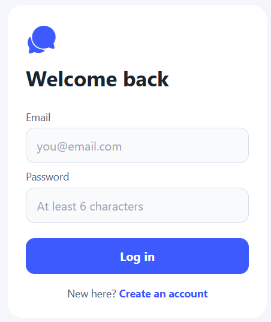
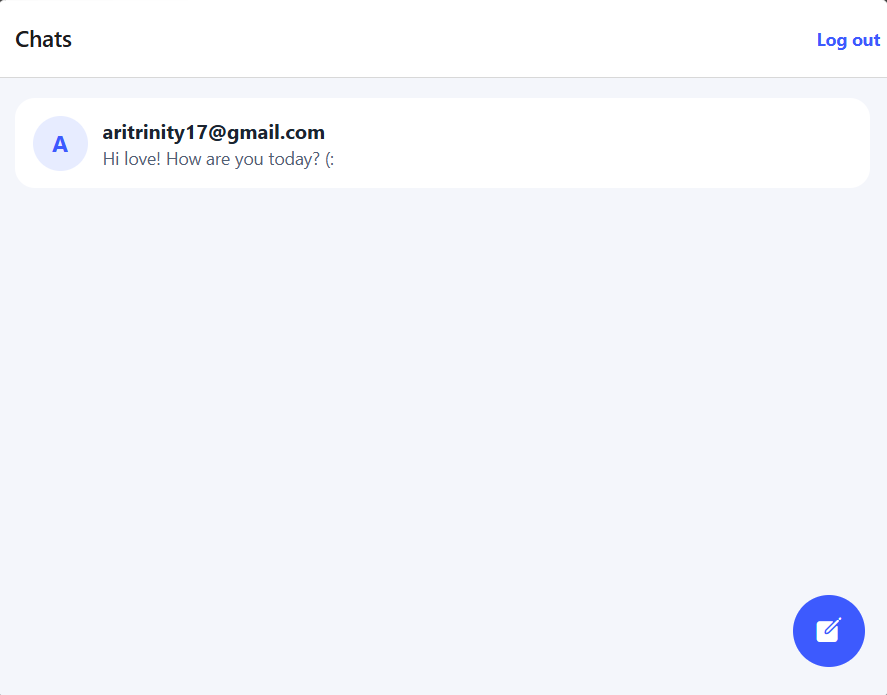
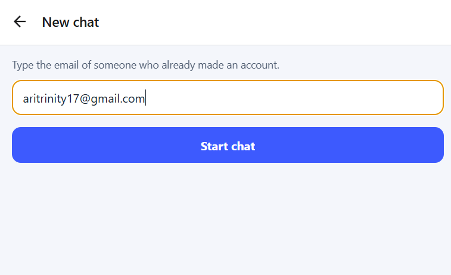
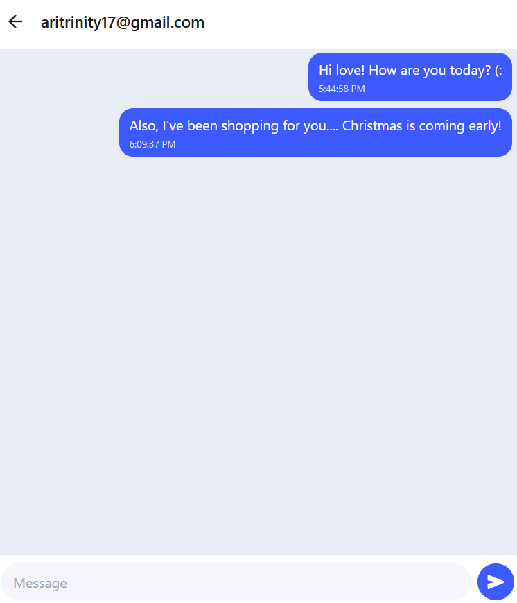
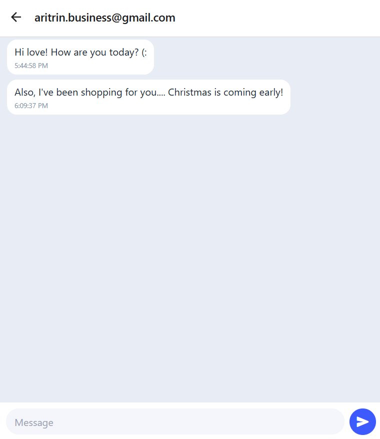

# Secure Chat App

> A real-time chat app built with React Native, Expo, and Firebase. Sign in with your email, start a chat with anyone by typing their email address, and watch messages appear instantly on both phones.

---

## Table of Contents

- [Description](#description)
- [How It Works — The Why & What Diagram](#how-it-works--the-why--what-diagram)
- [Features](#features)
- [Screenshots](#screenshots)
- [Usage / Examples](#usage--examples)
- [Installation](#installation)
- [Tech Stack](#tech-stack)
- [Author Information](#author-information)

---

## Description

- **Secure Chat App** is a mobile chat application built for the W4 assignment, using React Native, Expo, and Firebase
- Users register and log in with an email and password, handled by **Firebase Authentication**
- A chat is started by typing the other person's **email address** — no usernames to search for
- Messages are stored in **Cloud Firestore** and sync in real time, so both people see new messages the moment they're sent
- Every chat room is **private**: only the two people in the room can open it, enforced by Firestore security rules
- The app is written in **TypeScript**, with loading states and error messages built in from the start — not added at the end

---

## How It Works — The Why & What Diagram

This is the map of what we built and why each piece exists. Read it top to bottom: it follows one message from your fingers to your friend's phone.

```text
+--------------------------------------------------------------+
|  THE GOAL (WHY)                                              |
|  Two people, on two different phones, chatting instantly     |
|  and privately — and staying logged in between visits.       |
+-------------------------------+------------------------------+
                                |
                                v
+--------------------------------------------------------------+
|  SCREENS — what you see and tap (expo-router)                 |
|  Login / Register  ->  Chat List  ->  Chat Room              |
+-------------------------------+------------------------------+
                                |
                                v
+--------------------------------------------------------------+
|  AuthContext — the app's memory of WHO is logged in          |
|  WHAT: wraps the whole app and shares the current user       |
|  WHY: every screen needs to know it's you — and chat         |
|       screens can turn away anyone who isn't signed in       |
|  + AsyncStorage: saves the login on the phone, so you        |
|    don't have to sign in again every time you open the app   |
+-----------------------+-------------------+------------------+
                        |                   |
                        v                   v
+-------------------------------+  +---------------------------+
|  Firebase Authentication      |  |  Cloud Firestore          |
|  WHAT: checks your email +    |  |  WHAT: the online         |
|  password and signs you in    |  |  database that stores     |
|  WHY: only real, signed-in    |  |  chat rooms and messages  |
|  users get into the app       |  |  WHY: messages live in    |
|                               |  |  the cloud, so both       |
|                               |  |  phones see the same      |
|                               |  |  conversation             |
+-------------------------------+  +--------------+------------+
                                                  |
                                                  v
                                   +----------------------------+
                                   |  onSnapshot — the listener |
                                   |  WHAT: "listens" to a chat |
                                   |  room's messages nonstop   |
                                   |  WHY: a new message pops   |
                                   |  in the instant it's sent  |
                                   |  — no refresh needed       |
                                   +----------------------------+
                                                  |
                                                  v
                                   +----------------------------+
                                   |  FlatList — the messages   |
                                   |  WHAT: draws the messages  |
                                   |  on screen and auto-       |
                                   |  scrolls to the newest one |
                                   |  WHY: long chats stay      |
                                   |  smooth, not slow or jumpy |
                                   +----------------------------+

  Wrapped around ALL of it:

  * Firestore Security Rules
    WHAT: a locked door on every chat room
    WHY: only the two people in a room can read or write in it

  * TypeScript interfaces (ChatRoom, Message)
    WHAT: a set shape that every room and message must match
    WHY: mistakes get caught while coding, not after the app breaks

  * Loading & error states
    WHAT: spinners while things load, clear messages when
          something goes wrong (like a wrong password)
    WHY: the user always knows what's happening
```

### The project structure (what lives where)

```text
secure-chat-app/
├── app/          # the screens (expo-router): login, chat list, chat room
├── components/   # reusable pieces: message bubble, chat list row, input bar
├── context/      # AuthContext — who is logged in, shared with every screen
├── config        # the Firebase setup file (keys + connection)
└── types         # the ChatRoom and Message interfaces (TypeScript)
```

---

## Features

- **Email & Password Login** – Register, log in, and log out securely with Firebase Authentication
- **Stay Logged In** – AsyncStorage remembers your login, so reopening the app takes you straight to your chats
- **Start a Chat by Email** – Type someone's email address to open a chat with them (the email format is checked first)
- **Real-Time Messages** – Firestore listeners sync messages instantly across devices — no refreshing
- **Secure Chat Rooms** – Each pair of people gets one unique room, and security rules keep everyone else out
- **Smooth Message Lists** – FlatList renders long conversations efficiently and auto-scrolls to the newest message
- **Loading & Error States** – Clear feedback while things load and when something goes wrong
- **Protected Screens** – Chat screens are only reachable when you're signed in
- **Type-Safe Code** – TypeScript interfaces for ChatRoom and Message keep the data consistent and catch errors early

---

## Screenshots

**Login / Register**



**Chat List**



**Starting a Chat by Email**



**Chat Room — Sending Messages**



**Real-Time Sync (message arriving on the other phone)**



---

## Usage / Examples

1. Open the app and **create an account** with your email and a password (or log in if you already have one)
2. You'll land on the **Chat List** — it shows every conversation you've started
3. Tap to start a new chat and **type the other person's email address**
4. Type your message and hit send — it appears in the room right away
5. The other person sees it **instantly** on their phone, and their replies pop into your screen the same way
6. Close and reopen the app — you're still logged in, and your chats are right where you left them
7. **Log out** from the chat list when you're done

### Example: what a message looks like in the code

Every message in Firestore follows the same shape, defined once as a TypeScript interface:

```tsx
interface Message {
  id: string;
  text: string;
  senderEmail: string;
  createdAt: Date;
}
```

### Example: how a private chat room gets its ID

Both people's emails are sorted and joined, so the same two people always land in the same room — no matter who started the chat:

```tsx
// One private room per pair of people
const chatRoomId = [myEmail, theirEmail].sort().join("_");
```

---

## Installation

**Before you start:** you'll need Node.js (v16 or higher) and npm installed, plus a free Firebase account.

1. **Clone the repository**

   ```bash
   git clone https://github.com/ari-trinity/YOUR-REPO-NAME.git
   ```

   > Replace **YOUR-REPO-NAME** with your actual repository name.

2. **Navigate into the project folder**

   ```bash
   cd YOUR-REPO-NAME
   ```

3. **Install the dependencies**

   ```bash
   npm install
   npm install @react-native-async-storage/async-storage @expo/vector-icons firebase expo-router expo-constants
   ```

4. **Set up Firebase**
   - Go to the Firebase Console and create a new project
   - Turn on **Authentication** and enable the **Email/Password** sign-in method
   - Create a **Cloud Firestore** database
   - Copy your project's config keys into the app's Firebase config file

5. **Start the app**

   ```bash
   npx expo start
   ```

6. Scan the QR code with Expo Go (or open an iOS/Android simulator) and the app will load

---

## Tech Stack

| Layer          | Technology                  |
| -------------- | --------------------------- |
| App Framework  | React Native + Expo         |
| Language       | TypeScript                  |
| Navigation     | Expo Router                 |
| Authentication | Firebase Authentication     |
| Database       | Cloud Firestore (real-time) |
| Saved Login    | AsyncStorage                |
| Icons          | @expo/vector-icons          |
| Styling        | React Native StyleSheet     |

---

## Author Information

**Ari Taylor** | Full-Stack Web Development | Atlas

- LinkedIn: [linkedin.com/in/ari-taylor-8b8382366](https://linkedin.com/in/ari-taylor-8b8382366)
- Email: [aritrin.business@gmail.com](mailto:aritrin.business@gmail.com)
- GitHub: [@ari-trinity](https://github.com/ari-trinity)
